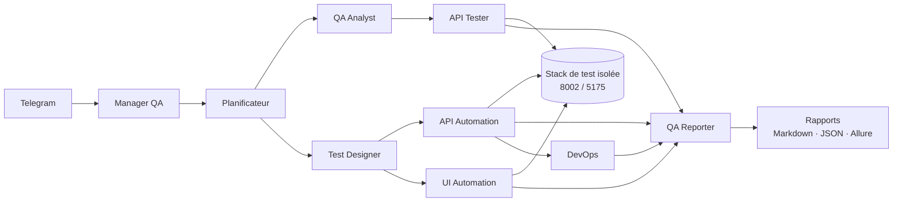

# Football QA Agents

**Système multi-agents qui planifie, exécute et documente des missions de test sur une application cible.**

[](https://github.com/MomoTeen07/football-qa-agents/actions/workflows/tests.yml)


> **Statut : 0.9.x — fonctionnel et durci, utilisé en local.**
> Les 9 phases de construction sont terminées. Le système n'est pas déployé publiquement et
> nécessite un environnement local (voir **Limites**).
> Points ouverts : [`docs/ROADMAP.md`](docs/ROADMAP.md).

---

## En 30 secondes

Une instruction en langage naturel envoyée à un bot Telegram devient une **mission de test** :
planification → analyse de l'API cible → conception des cas → exécution API et UI →
rapport Markdown, JSON et résultats Allure.

Rien n'est périodique ni automatique : **aucun scheduler**, aucune mission ne part sans
déclenchement explicite, et toute action sensible (Git, PR, publication) exige une approbation.

## Architecture



Vue simplifiée : 7 agents spécialisés autour d'un manager. Le code de chaque agent est dans
[`app/agents/`](app/agents/), l'orchestration dans [`app/orchestrator/`](app/orchestrator/).

## Ce qui est réellement vérifié

- **161 tests** couvrent l'orchestrateur lui-même — store SQLite, reprise après interruption,
  sécurité, bureau virtuel, agents, cohérence documentaire. Ce chiffre ne décrit **pas** les
  tests générés pour l'application cible.
- **CI** : `ruff check` puis `pytest` sur chaque pull request et sur `main`, Python 3.12,
  sans clé et sans réseau.
- **Isolation** : la mission cible uniquement la stack de test (`localhost:8002` / `localhost:5175`).
  Toute autre cible est refusée avant la première requête ; la base réelle n'est jamais écrite.
- **Sécurité** : barrière unique [`app/security.py`](app/security.py) (identifiants, chemins,
  références Git), rédaction des secrets à la sérialisation, en-têtes de sécurité et CSP,
  limite de flux SSE, SQLite en WAL avec reprise bornée.
- **Preuves** : chaque mission écrit ses artefacts dans `workspace/missions/<id>/`, agrégés par
  le reporter en rapport Markdown, synthèse JSON et résultats Allure 2.
- **Bureau virtuel 2D** : visualisation en lecture seule des agents, tâches et événements réels
  ([`office/`](office/)), servie uniquement sur la boucle locale.

## Lancer

Prérequis : Python 3.12, Docker, et l'application cible présente localement (voir **Limites**).

```bash
python -m venv .venv
.venv\Scripts\python.exe -m pip install -r requirements.txt
copy .env.example .env

# suite de tests du système
.venv\Scripts\python.exe -m pytest

# stack de test isolée (8002 / 5175 / 5434)
docker compose -f infra/docker-compose.test.yml -p football-qa-test up --build -d --wait
```

Commandes détaillées, configuration des clés Gemini et Telegram, missions par phase et
dépannage : [`docs/GUIDE.md`](docs/GUIDE.md).

## Structure

```text
app/          manager, planificateur, agents, outils, sécurité
app/llm/      client LLM avec repli déterministe hors ligne
app/tools/    sondes API, suites générées, Allure, DevOps
office/       bureau virtuel 2D (HTML/CSS/JS, sans build)
infra/        stack Docker de test isolée
scripts/      lancement des missions par phase
tests/        tests du système multi-agents
workspace/    espaces de travail par mission
```

## Documentation

| Document | Contenu |
| --- | --- |
| [`docs/ROADMAP.md`](docs/ROADMAP.md) | état d'avancement et points ouverts |
| [`docs/GUIDE.md`](docs/GUIDE.md) | guide complet : principes, configuration, commandes, Telegram, phases, dépannage |
| [`CHANGELOG.md`](CHANGELOG.md) | historique daté des modifications |
| [`PROJECT_CONTEXT.md`](PROJECT_CONTEXT.md) | notes de reprise détaillées |

## Limites

- **Non reproductible en l'état** : `infra/docker-compose.test.yml` construit l'application cible
  depuis un dossier voisin (`../../MyFinalProject`), absent du dépôt public. C'est le premier point
  de la feuille de route.
- Le système est conçu pour un **usage local mono-utilisateur**, pas pour un déploiement partagé.
- Sans clé LLM, les agents basculent sur un **repli déterministe** : les tests passent, mais
  l'analyse n'est plus enrichie.
- L'application cible utilisée pendant le développement est [`football-qa`](https://github.com/MomoTeen07/football-qa).

## Licence

[MIT](LICENSE).
